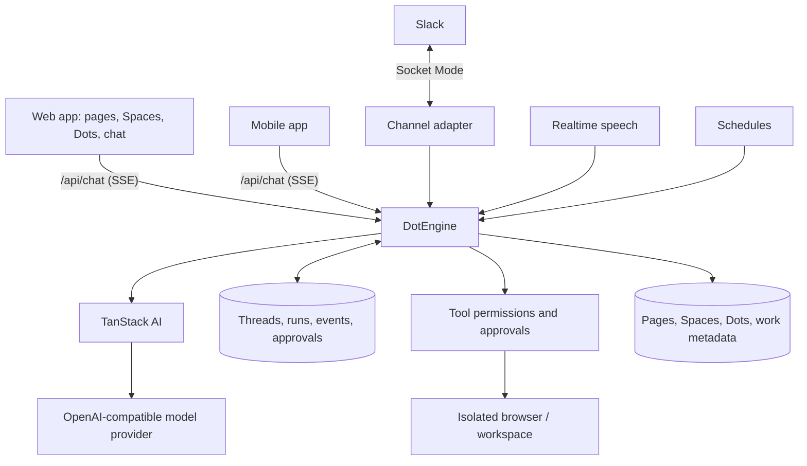

<div align="center">

# OpenDots

### Always-on AI coworkers that move between text, calls, and Slack.

**An open-source template for persistent AI agents, each with its own computer. Available on Web and Mobile.**

Built with [AG-UI](https://docs.ag-ui.com/introduction) events and [TanStack AI](https://tanstack.com/ai). · [Get started](#get-started) · [Overview](#overview) · [Architecture](#architecture) · [Features](#features) · [Contributing](CONTRIBUTING.md)

[](https://github.com/CopilotKit/OpenBot)
[](https://github.com/CopilotKit/OpenDots/actions/workflows/ci.yml)
[](./LICENSE)


<a href="https://trendshift.io/repositories/275323" target="_blank"></a>

Host OpenDots on your own infrastructure. Conversations, pages and approvals are stored in your own Postgres database, so a model key is all you need. Slack connects directly from your server. Clone this template and customize it however you want.

**OpenDots is now available as a UX skin in [OpenBot](https://github.com/CopilotKit/OpenBot)**, a more robust version with sign-in, per-Bot permissions and an audit trail, maintained by CopilotKit. This repo stays a community-maintained starter for building your own project.

<a href="https://github.com/CopilotKit/OpenBot"></a><br>
<sub>OpenBot with the OpenDots skin, picked under Settings → Skin</sub>

[**Bringing OpenDots to your company? Talk to us about OpenBot →**](https://www.copilotkit.ai/talk-to-an-engineer?ref=opendots_readme)

</div>

---

<div align="center">

<table><tr><td>

https://github.com/user-attachments/assets/4c74fe7d-ecdd-42dd-95da-5d34f9b9576e

</td></tr></table>

</div>

_Ask → browse → approve → save. A live computer view and a human review card appear right in chat, then the approved draft becomes an editable Space page. Enlarged for readability; idle time is trimmed and playback is accelerated._

## OpenDots and OpenBot

OpenDots also ships as a skin in [OpenBot](https://github.com/CopilotKit/OpenBot), CopilotKit's open-source agent platform, alongside [OpenMuse](https://github.com/CopilotKit/openmuse) and [OpenDuet](https://github.com/CopilotKit/OpenDuet). Pick it there and you get OpenDots's look, with everything OpenBot does underneath.

| If you want to                                                             | Start here                                                                                        |
| -------------------------------------------------------------------------- | ------------------------------------------------------------------------------------------------- |
| Try OpenDots, or fork its interface                                        | This repo: [Get started](#get-started)                                                            |
| Run it for your team, with sign-in, per-Bot permissions and an audit trail | [OpenBot](https://github.com/CopilotKit/OpenBot#quick-start), then **Settings → Skin → OpenDots** |
| Have us stand it up inside your company                                    | [Talk to an engineer](https://www.copilotkit.ai/talk-to-an-engineer?ref=opendots_readme_openbot)  |

OpenDots, OpenMuse and OpenDuet are community maintained, and issues and pull requests are welcome in each repo. OpenBot is the one the CopilotKit team maintains and ships fixes to.

## Overview

OpenDots is a starting point for building your own agent workspace. Clone it, define your Dots, connect your services, and adapt the interface and tools to your needs.

**A template, not a hosted product.** You run the application and configure its infrastructure. The template is in early development; the Features section below describes what's included and distinguishes local verification from connected-service testing.

### Spaces

A Space is a home for working documents. Dots appear separately in navigation and can be granted access to multiple Spaces in their settings. Each Dot has a default destination for saved pages; existing installations retain their original Space access. Browse pages in a searchable library, switch between grid and list views, and organize documents as nested subpages. Open a page in a focused visual editor with formatting, slash commands, and undo/redo. Write directly, save a conversation as a page, or ask a specialist to create and revise content.

Pages stay in the local workspace database. Each page and specialist pair has its own conversation. Page links connect the document workspace to Dot chat. Manual editing works before you configure conversation services. Autosave reports its progress, failed saves retain your draft, and revision checks prevent stale edits from overwriting newer content. Markdown source mode remains available.

<div align="center">

<table><tr><td>

https://github.com/user-attachments/assets/d20c3405-4339-49e7-a799-43298728015c

</td></tr></table>

</div>

_Open a Space, navigate to its launch brief, ask Scout about the saved page, and continue in Dot chat. This recording uses live page chat and example launch content._

### Specialist Dots

Give each Dot a name, role, instructions, and permitted tools. A researcher can investigate a topic; a writer can turn findings into a draft. Inspect their work and control what they can do.

### Dot computers

Each Dot can have its own computer, using [OpenBot](https://github.com/CopilotKit/OpenBot)'s container supervisor and computer service. Its browser profile and workspace files persist across stop/start. The Computer panel exposes browser control, human takeover, files, terminal output, and activity, with browser, file, and shell permissions set per Dot. The application keeps service credentials on the server and derives a different computer credential for each Dot.

See [Computer setup](docs/COMPUTERS.md) to build the pinned services and connect your deployment. Computer tools require those services; an unconfigured template does not execute commands on your host.

<div align="center">

<table><tr><td>

https://github.com/user-attachments/assets/30b691c3-0f66-4964-9fdb-67d4feab5568

</td></tr></table>

</div>

_Ask Scout to open a website, summarize it, save notes, and verify the file. Every computer action in this demo is requested through chat; tool cards show the live browser, saved file, and terminal output inline._

### Review before saving

Ask a Dot to show a draft before saving it. An approval card pauses the turn for **Approve & save** or **Decline**, in the web or mobile app. The server saves the page in an authorized Space only after you approve and gives the Dot its link; the Dot continues after your decision. Connected-service tools set to **Ask first** use the same cards.

### Connections

Give a Dot tools from any MCP server, such as email, calendar, GitHub, or your own services. Read-only tools run on their own. Any other tool pauses for an **Approve & run** card in chat, and only your approval runs it. You can turn each tool on or off per Dot. See [Connections](docs/CONNECTIONS.md).

### Connected apps

Dots can use [Composio](https://composio.dev) to work with the owner's email, calendar, and other connected apps. Add `COMPOSIO_API_KEY`, restart OpenDots, then enable Connected apps in both the global settings and the Dot's settings. Adding the API key alone does not grant access.

You can limit each Dot to toolkit slugs such as `gmail` or `googlecalendar`. A blank toolkit list allows every toolkit in the Composio project. OpenDots identifies the owner with `OWNER_ID`, so keep that value stable after connecting accounts. Sign in to apps on the **Accounts** page, or follow the Connect link a Dot returns in chat when a tool needs authentication.

These tools act on real accounts. Start with a read-only request and use a test account before trying write actions. See [Composio setup](docs/SETUP.md#composio) for configuration, permissions, testing, and data-sharing details.

### Text and calls

A continuous conversation keeps the Dot's avatar and status above the messages, with text and call controls close at hand. Work updates, source links, and call receipts appear in the timeline; a side panel shows results or the agent's computer.

Calls pair realtime speech with a separate compute agent, so the conversation can continue while longer work runs. Both use the same conversation context and tool permissions. The call screen includes a live timer, separate user and Dot captions, microphone mute, speaker mute, and a minimized view for continuing in chat. Voice needs separate provider configuration.

<div align="center">

<table><tr><td>

https://github.com/user-attachments/assets/3c06cf71-39ed-4e2b-b846-5463b2722389

</td></tr></table>

</div>

_Connect, talk, mute, minimize, and return to chat. This is a silent screen capture of a real call, with waiting time trimmed and playback accelerated._

### Slack

Mention a Dot in Slack, or send it a direct message, then continue in its thread. OpenDots connects over Slack's Socket Mode, so your server needs no public address, with an explicit workspace/user allowlist and a selected specialist. See [Slack setup](docs/SETUP.md#slack) to connect your deployment.

<div align="center">

<table><tr><td>

https://github.com/user-attachments/assets/27d03a6c-a9e0-4c29-8d96-fafe0fbae20f

</td></tr></table>

</div>

## Architecture

### AG-UI connects the agent to the interface

[AG-UI](https://docs.ag-ui.com/introduction) event shapes carry streamed messages and tool calls from the server to the web and mobile apps over Server-Sent Events. Computer activity appears inline as the agent works; approval cards pause a tool on the server until you decide.

One engine runs every turn: chat from the web and mobile apps, voice, schedules, delegation between Dots, and Slack. It builds each Dot's prompt and tools and runs the model loop on TanStack AI. Every event is stored as it streams, so history survives restarts and a refresh mid-answer picks the stream back up.



You configure the model provider for your deployment, and optionally Slack; calls also need a speech provider. Credentials stay on the server. Missing configuration should produce a clear setup state, and test fixtures should remain visibly separate from live integrations.

[OpenMuse](https://github.com/CopilotKit/OpenMuse) and [OpenBot](https://github.com/CopilotKit/openbot) are code references for persistent work, agent computers, and execution controls. OpenDots can be adapted to your own workflows and deployment choices.

## Get started

Use **Node.js 24** and **npm**:

```sh
git clone https://github.com/CopilotKit/OpenDots.git
cd OpenDots
npm ci
cp .env.example .env
npm run db   # Postgres in Docker
npm run dev
```

Open **http://127.0.0.1:5173**. You can create Spaces, write pages, and configure Dots before connecting services. To start chatting, add `OPENAI_API_KEY` and `OPENAI_MODEL` to `.env` and restart `npm run dev`.

See [Setup](docs/SETUP.md) for configuration, Slack, calls, the browser service, and Docker.

## Data and privacy

Conversation messages, tool calls, run events and approvals are stored in your Postgres database (`DATABASE_URL`), alongside pages and workspace metadata. Back up that database to back up everything. Upgrading from a release that used SQLite: see [moving from SQLite](docs/SETUP.md#moving-from-sqlite).

The configured model provider receives conversation context, including authorized page content and tool results. Public-web research sends queries and selected URLs to Parallel by default; set `WEB_SEARCH_PROVIDER=disabled` to disable those tools. When connected apps are enabled, tool arguments and results pass through Composio and the app provider. Speech and Slack send data to their providers when used.

OpenDots records bounded browser setup stages and first successful assistant activation with a random installation ID; no prompts, answers or keys. Set `DO_NOT_TRACK=1` or `COPILOTKIT_TELEMETRY_DISABLED=true` to opt out, which also purges pending setup events. See [browser setup telemetry](docs/SETUP-TELEMETRY.md) and [telemetry](docs/TELEMETRY.md). Review the policies and retention settings of each service you configure.

## Features

| Area                       | Included                                                                                                            |
| -------------------------- | ------------------------------------------------------------------------------------------------------------------- |
| Spaces and Specialist Dots | Saved names, role instructions, and per-Dot research and memory permissions                                         |
| Pages                      | Searchable library, visual editor, slash commands, autosave, and revision checks                                    |
| Conversations              | Stored locally; live streaming across devices, resume after refresh, page-specific conversations, and source links  |
| Slack                      | Socket Mode adapter, one OpenDots thread per Slack thread, workspace and user allowlists                            |
| Calls                      | WebRTC speech, delegated compute, bounded sessions, hangup, and timeline receipts                                   |
| Background work            | Scheduled server-side turns in their original conversation, with pause and retry controls                           |
| Browser                    | Separate read-only public-page service with page capture and navigation limits                                      |
| Dot computers              | Per-Dot browser profiles, files, shell, takeover, permissions, and action records through OpenBot                   |
| Connections                | Per-Dot MCP servers, Composio connected apps, per-tool access, and server-side owner approval for MCP write actions |
| Appearance                 | System, light, and dark themes; dark colors are derived at build time from the light styles                         |
| Memory                     | User-managed preferences that permitted Dots can use                                                                |
| Deployment                 | Local Node setup and separate application/browser containers                                                        |

Scheduled tasks run in their original conversation. If a worker stops or its lease expires during a run, OpenDots marks that run **Interrupted** and waits for an explicit retry. Review its pages and computer actions, then use **Retry after review** when appropriate. Completed effects may already be present even when a run has no final result.

Local checks cover setup, persistence, streaming and resume, approvals, permissions, failure handling, and browser isolation. Automated tests use service fixtures. **Live model responses and page-context chat were verified on September 29, 2026, before phase 4 moved chat onto the OpenDots engine.** Live OpenBot computer browsing, file creation, shell verification, and file persistence across stop/start were also verified locally. Live Realtime speech, call controls, and receipt persistence were verified locally on September 30, 2026. The Slack adapter and spoken compute delegation still need connected-service verification. See [recording notes](docs/demos/README.md) for the demonstrated flows and limits.

This is a single-owner starting point. Shared editing, invitations, file uploads, and interactive page embeds are not included. Schedules are recurring instructions, not a complete goal or event-trigger system. Specialist Dots have separate roles and conversations; multi-Dot group conversations and automatic delegation are further work.

### Extending the template

- Add identity, Space membership, and shared page editing for multi-user deployments.
- Add file attachments and richer page content.
- Add event triggers and a persistent responsibility lifecycle.
- Extend tools and approval flows for your own workflows.
- Add richer artifacts, connected-app context, and specialist coordination.

## Contributing

See [Contributing](CONTRIBUTING.md) for development guidance and [Security](SECURITY.md) for reporting issues. Contributions should describe the workflow they enable, include verification evidence, and distinguish live integrations from fixtures.

## References

- [AG-UI documentation](https://docs.ag-ui.com/introduction)
- [TanStack AI](https://tanstack.com/ai)
- [Slack Socket Mode](https://api.slack.com/apis/socket-mode)
- [OpenMuse](https://github.com/CopilotKit/OpenMuse)
- [OpenBot](https://github.com/CopilotKit/openbot)

## License

[MIT](LICENSE).

## Public-web research

Parallel is selected by default in live research and Dot conversations. Ask a topic-only question to discover and read up to five sources, or supply URLs to extract them directly. Sources are saved with their links. A browser worker is not required for this research path; computer tools remain available for interactive work.

`WEB_SEARCH_PROVIDER=browser` preserves the existing URL-only browser reader, and `WEB_SEARCH_PROVIDER=disabled` disables these research tools. Workspace and Dot research permissions, pause and cancellation controls still apply. Sample research remains fictional and does not contact a provider.

Queries, requested URLs, a stable session identifier and the research objective are sent to `https://search.parallel.ai/mcp`. Memories and complete conversations are not automatically forwarded to Parallel. Model-selected objectives may still contain context from the conversation. The anonymous service is free for light use with provider-managed limits; set `PARALLEL_API_KEY` on the server for production or higher limits. Provider errors and empty results are reported rather than replaced with invented evidence. See [Parallel Search MCP documentation](https://docs.parallel.ai/integrations/mcp/search-mcp).
