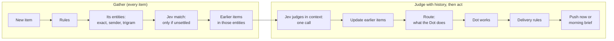

# Discovery: how items are judged

Discovery watches your connected accounts (Gmail, Outlook and Teams), decides what needs you, and has a Dot look into it. Setup is in [SETUP.md](SETUP.md#discovery); the code is in `src/server/discovery/` and `src/server/inbox/`.

It solves four problems a one-item-at-a-time triage has:

1. **Threads drift and age.** A request, its invoice and a payment reminder drift across categories, and a short time window misses anything older. Identifiers such as invoice numbers, email addresses and domains stay the same across both.
2. **Items need their history.** An email is flagged, then a Teams message says "ignore that email". The Teams message must be judged with the email in view.
3. **Not everything should interrupt.** Something that can wait until tomorrow should not push now, like an outage.
4. **Not every item needs the same work.** The Dot drafts a reply, proposes an action you approve, or only tells you, depending on what's asked and what it's allowed to do.

The design follows the TypeSafe skill (`.claude/skills/typesafe-ai/SKILL.md`): **Jev makes judgments, code makes decisions.** Jev never decides what to do or what the Dot may do. It answers small questions, and code maps the answers to an outcome through the tables below.

## 1. Gather: find every earlier item this could relate to

This runs for every item that passes the rules, before any judgment. Otherwise "ignore that email" is never connected to the email.

- **Rules**: mail the app filed as promotions, social, forums or spam is dropped with no Jev call.
- **Catch up memory**: every earlier item not yet in memory is distilled first ([MEMORY.md](MEMORY.md)), so an item is judged against everything that came before it, even a minute before.
- **Its entities**: a recall-tuned regex finds possible identifiers (invoice and PO numbers, amounts, email addresses, domains, names). Each is normalized (`INV-2041`, `inv 2041` and `Invoice #2041` become one key) and matched to the owner's entities the way memory matches them: exact names and identifiers, then the sender's address and company domain, then near spellings by trigram similarity (`pg_trgm`). This is free. Names seen for the first time have no history and are left out.
- **Earlier items**: every earlier item in those entities' facts, scored by what links them: an invoice, order or ticket 3, a project, place or name 1.5, a person 1, the same sender 1 (0.5 after three days), a company 0.5. The ~12 strongest go to Jev, each with why it was picked, strongest reason first. Items already pruned come from their facts alone (title, sender, date, amounts and outcome), so history reaches back past the retention window; they can inform the judgment but can't be linked or updated.
- **Jev match**: only when code finds several or no clear matches for a person or name. It follows TypeSafe's [infinite cardinality choice](https://docs.typesafe.ai/cookbooks/infinite_cardinality_choice.md) cookbook:
  1. One yes/no question per known entity of that type, about 300 per call.
  2. A re-read of the top ~80 with longer text, only when more than ~20 remain.
  3. One Choice over the top ~20.

  In that cookbook, Jev's yes/no pass got the right answer into the final pick 82% of the time, against 35% for embedding search (OpenAI `text-embedding-3-small`). The re-read raised that to 88%, and a Choice confidence of 0.8 or more was right in all 48 such cases. That is why Jev, not embeddings, decides that two names are the same thing. Jev's answer is kept for the item, so distilling it later doesn't ask again.

## 2. Judge with that history

**Jev judges in context**: one call per item, with the item and the gathered earlier items in its state. Questions that share this state are bundled into the call, including ones whose answers are only needed in some cases ("ask speculatively" in the skill).

| About             | Question                                                                                                                                                               | Type                                                                                                                                                  |
| ----------------- | ---------------------------------------------------------------------------------------------------------------------------------------------------------------------- | ----------------------------------------------------------------------------------------------------------------------------------------------------- |
| The item          | Does the owner need to look at it?                                                                                                                                     | Noul                                                                                                                                                  |
| The item          | What kind is it?                                                                                                                                                       | Choice                                                                                                                                                |
| The item          | How urgent is it? Levels: can wait days, by tomorrow, today, within hours                                                                                              | Score                                                                                                                                                 |
| The item          | What is asked? Information, a reply, an action, a decision only the owner can make                                                                                     | Choice, with a Noul for "anything asked at all"                                                                                                       |
| The item          | Does it try to instruct an AI assistant? (prompt injection)                                                                                                            | Noul                                                                                                                                                  |
| The item          | Which regex span is the real invoice number, person and so on                                                                                                          | Choice per tag, from the regex's own hits ([pre-parsed value extraction](https://docs.typesafe.ai/cookbooks/pre_parsed_value_extraction_cookbook.md)) |
| Each earlier item | Same thing? Different, possibly, or definitely ([entity alignment](https://docs.typesafe.ai/cookbooks/entity_alignment.md))                                            | Score                                                                                                                                                 |
| Each earlier item | Does the new item say it no longer needs the owner?                                                                                                                    | Noul                                                                                                                                                  |
| Each earlier item | Does the new item make it more urgent?                                                                                                                                 | Noul                                                                                                                                                  |
| Each earlier item | Does it hold facts useful for answering? Does it contradict the new item? ([classifying RAG passages](https://docs.typesafe.ai/cookbooks/classifying_rag_passages.md)) | Noul each                                                                                                                                             |

Nouls use 0.7 and 0.3 as starting thresholds; the band between counts as unsettled. Every raw answer is stored in `discovery_findings`, so thresholds can be retuned on past items without new calls.

**Update earlier items** (code): a "same thing" link at 0.8 or more is recorded. Lower scores go to a review queue, or are left unlinked below 0.5.

- **"No longer needed":** marks the earlier finding resolved and cancels its queued push. If the push already went out, a short correction follows. Other open items about the same invoice, order or ticket, which both items mention, are resolved with it: "INV-2041 is paid" closes the invoice and its reminder.
- **"More urgent":** escalates the earlier item. This is accepted from anyone.
- **Downgrades and cancels:** only accepted from the owner, the earlier item's sender (same address), or someone in the owner's organisation (same domain or Teams tenant). From anyone else the item stays flagged with a note ("X says this can be ignored"). This stops a scam or injection email from hiding a real invoice. It's fixed for now and can become a setting later.

## 3. Route: what the Dot does

Code combines "what is asked" with two checks: whether a connected tool can do the action, and whether the owner allows it. The owner sets the allowed list per app, and nothing is allowed until they add it.

| What is asked                              | Can the Dot do it? | What happens                                               | Example                     |
| ------------------------------------------ | ------------------ | ---------------------------------------------------------- | --------------------------- |
| Nothing, it's information                  | Nothing to do      | Tell the owner; no investigation                           | Deploy finished             |
| A reply                                    | Yes, as a draft    | Investigate, draft it, the owner approves sending          | A client's question         |
| An action a connected tool can do          | Yes, if allowed    | Investigate, propose it, the owner approves with one tap   | Someone asks for app access |
| An action it can't do, or isn't allowed to | No                 | Tell the owner what, where and who, with read-only context | A bug on prod               |
| A decision only the owner can make         | No                 | Gather the facts and options, propose nothing              | Contract terms              |

The Dot stays read-only until the owner approves. Replies are drafted in the OpenDots conversation (not yet in the mailbox's drafts folder), and other changes become proposals.

## 4. Delivery: now, or the morning brief

| Urgency              | Needs the owner's decision? | What happens                                     |
| -------------------- | --------------------------- | ------------------------------------------------ |
| Within hours         | Either                      | Push now; a draft follows if possible            |
| Today                | No                          | Draft it, then push "draft ready"                |
| Today                | Yes                         | Push now with the options                        |
| By tomorrow or later | No                          | Draft overnight; approve it in the morning brief |
| By tomorrow or later | Yes                         | Morning brief, under decisions                   |

- **Quiet hours:** during quiet hours, "today" items wait for the morning brief, and only "within hours" breaks through.
- **Hold window:** non-urgent pushes wait a few minutes so a quick follow-up can cancel them.

## Jev calls per item

| Situation                                         | Jev calls                                             |
| ------------------------------------------------- | ----------------------------------------------------- |
| Dropped by the rules                              | 0                                                     |
| Every item past the rules                         | 1                                                     |
| A tag code can't settle                           | +1 to 6                                               |
| More than 20 candidates left after the first pass | +1 to 2                                               |
| Item that needs the owner                         | 0 extra (its context questions are in the first call) |

## Storage

- **Entities** (`entities`, `entity_aliases`, `entity_edges`, `event_entity_links`): where history comes from. See [MEMORY.md](MEMORY.md).
- **`discovery_findings`**: also stores Jev's raw answers per item, and why each earlier item was gathered.
- **`event_links`**: items Jev found to be the same thing, and the owner's confirmations and rejections, to measure and tune matching. Pruned with the item.
- **Indexes**: `pg_trgm` on person and name aliases.

Tags (`event_tags`) and per-item embeddings (`item_embeddings`) were dropped in migration 15: entities replace both.

## Where it lives

- Jev questions: `src/server/discovery/classifier.ts`
- Tags and free-form names: `src/server/inbox/tags.ts`; matching them to entities: `src/server/memory/service.ts`
- Gathering history, judging in context, and deciding in three steps (link earlier items, save the finding, follow up on earlier items): `src/server/discovery/service.ts`
- Routing, delivery, quiet hours, hold window, morning brief and corrections: `src/server/discovery/delivery.ts`
- Proposals (prepare, handle, not now): `src/server/discovery/proposals.ts`, `proposal-store.ts`

The thresholds are starting values and have not been tuned on real items yet.

**Not built from this design:** the Choice per tag over the regex's own spans (pre-parsed value extraction), the re-read pass of the Jev match (names have no longer text to re-read), Teams tenant as "your organisation" (domains only), and drafting overnight (items are investigated as they arrive and only delivered in the brief).
