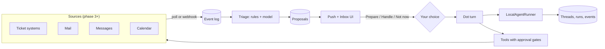
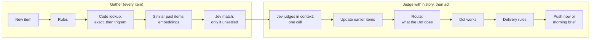
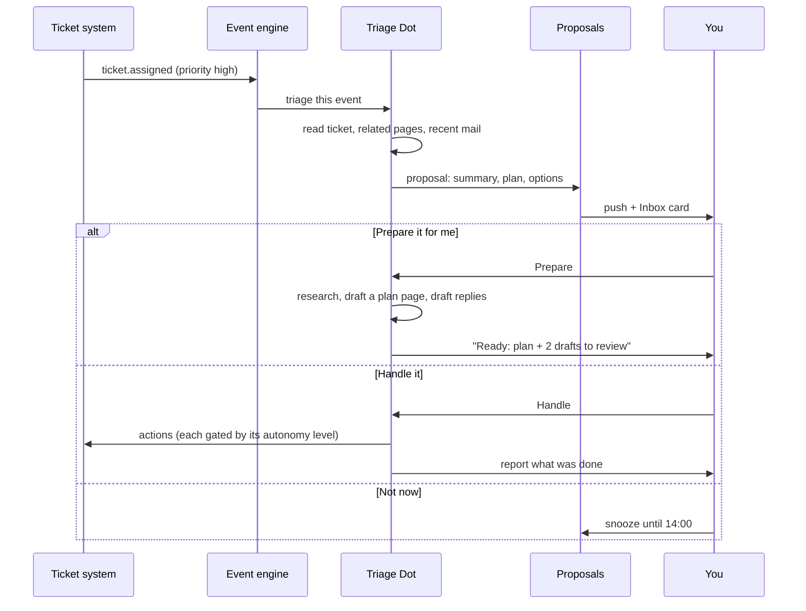

# Roadmap: your own backend and a personal assistant

This plan takes OpenDots from "needs a CopilotKit account" to a self-contained personal assistant that watches your work, tells you what matters, and offers to prepare or handle it. Each phase ships something usable on its own, and each one adds a seam the next phase plugs into.

Phase 1 replaced the hosted Intelligence service. Phase 4 removed the CopilotKit SDK itself (`@copilotkit/runtime`, `@copilotkit/react-core`, `@copilotkit/core`, `@copilotkit/channels`), so OpenDots runs on its own code plus a model provider.

## Where we are today

| Piece                                 | Provided by            | Code                                                    |
| ------------------------------------- | ---------------------- | ------------------------------------------------------- |
| Conversation storage, streaming, stop | Our code + Postgres    | `src/server/engine/thread-runner.ts`, `chat-routes.ts`  |
| Agent loop, tools                     | Our code + TanStack AI | `src/server/engine/index.ts`, `engine/tools.ts`         |
| Approvals                             | Our code + Postgres    | `src/server/engine/approvals.ts`                        |
| Web and mobile chat client            | Our code               | `src/shared/thread-client.ts`, `useThread.ts`           |
| Slack                                 | Our code (Socket Mode) | `src/server/channels/`                                  |
| Event engine, insights, delegation    | Our code + Postgres    | `src/server/inbox/`, `insight-routes.ts`, `platform.ts` |
| Pages, Dots, schedules, MCP, push     | Our code + Postgres    | `store.ts`, `workspace.ts`, `push.ts`, ...              |

No CopilotKit package or account is needed. `@ag-ui/core` remains for event types.

## Where we are going



## Design rules that keep it extensible

1. **Every outside dependency sits behind an interface.** Conversation storage, sources, notifiers and learning each get one. Adding Outlook next to Gmail, or Postgres next to SQLite, means adding a class, not editing call sites.
2. **Everything that happens is an event first.** A new ticket, a new mail, a meeting change: each is written to one `inbox_events` table before anything acts on it. Replays, audits and "why did it do that?" all come from that table.
3. **Nothing acts without a level of permission you chose.** Autonomy is set per source and per action (see [Autonomy levels](#autonomy-levels)). The default is the lowest.
4. **Reuse the gates we already have.** MCP "Ask first" approvals, page review cards, task leases and push notifications already exist. New features route through them instead of inventing new ones.
5. **Read before write.** Each new source ships read-only first (summaries, digests), then drafts, then actions.

## Phase 1: Own the conversations (essentials)

**Status:** implemented. See `src/server/conversations/` (`LocalAgentRunner`, `ConversationBackend`, thread naming) and `tests/local-runner.test.ts`, `tests/local-platform.test.ts`.

**Goal:** OpenDots chats, resumes and runs schedules with no CopilotKit account. Intelligence becomes an optional backend.

**Seam:** a `ConversationBackend` chosen by `CONVERSATION_BACKEND=local|intelligence` (default `local`).

```ts
// src/server/conversations/backend.ts
interface ConversationBackend {
  runner(): AgentRunner; // from @copilotkit/runtime/v2
  createThread(input: { dotId: string; title?: string }): Promise<string>;
  listThreads(ownerId: string): Promise<ThreadSummary[]>;
  renameThread(threadId: string, title: string): Promise<void>;
  archiveThread(threadId: string): Promise<void>;
  history(threadId: string): Promise<Message[]>;
  turn(
    threadId: string,
    prompt: string,
    signal: AbortSignal,
    meta?: object,
  ): Promise<string>;
}
```

**Work:**

- `LocalAgentRunner` implementing `AgentRunner` (`run`, `connect`, `isRunning`, `stop`). Start from `InMemoryAgentRunner`'s behaviour and persist to SQLite:
  - `conv_threads(id, dotId, ownerId, title, createdAt, updatedAt, archivedAt)`
  - `conv_runs(id, threadId, status, startedAt, finishedAt, error, inputTokens, outputTokens)`
  - `conv_events(threadId, runId, seq, type, payload, createdAt)` append-only AG-UI events
- Resume: `connect` replays stored events then follows the live run. A per-thread lock blocks two runs on one thread (matches `AGENT_THREAD_LOCKED` in `Chat.tsx`).
- Thread naming: one small model call after the first turn.
- Move `headless.ts` (voice, schedules) onto `backend.turn()`.
- `Platform` builds `CopilotRuntime` with `runner: backend.runner()` when local; keeps the current Intelligence wiring when `intelligence`.
- `setupStatus` only requires a model key in local mode.
- `learning.ts` becomes a no-op in local mode until phase 8.

**Done when:**

- Chat works with `CPK_INTELLIGENCE_API_KEY` empty.
- History survives a server restart.
- Refreshing mid-answer reconnects and finishes the stream.
- Scheduled tasks and voice calls write into the same thread.
- Existing tests pass; new tests cover the runner's replay, lock and stop.

**Rough effort:** 3–4 weeks.

## Phase 2: See what it is doing

**Status:** implemented. See **Insights** in the web app, `src/server/insight-routes.ts` (`GET /api/runs`, `/api/runs/:id`, `/api/usage`, `/api/audit`), `src/server/usage-store.ts`, `src/server/conversations/inspect.ts` and `tests/insights.test.ts`.

- The run inspector needs local conversations; usage and audit work with either backend because the Dot records token usage itself when a run finishes (`usage_ledger`).
- The cap is in tokens per UTC calendar month (`monthlyTokenCap` on the Dot, set in its settings). At the cap the Dot stops starting new turns, including schedules, with a message saying why. A turn already running is allowed to finish.
- Ungated MCP calls and Composio tools had no receipt table, so they are now logged in `action_log` and joined with `mcp_actions` and `computer_audit`.

**Goal:** trust and cost control before giving it more access.

- **Run inspector:** a page per run showing prompt, tool calls, approvals, timings and errors, read from `conv_events`.
- **Cost meter:** token counts per run (already captured in `conv_runs`), totals per Dot and per day, an optional monthly cap per Dot that pauses it.
- **Audit view:** one list of every action taken outside OpenDots (MCP actions, computer actions, sends), joining the existing `mcp_actions` and `computer_audit` tables.

**Rough effort:** 1–2 weeks.

## Phase 3: The event engine

**Status:** implemented. See **Inbox** in the web app, `src/server/inbox/` (`Source`, `InboxStore`, `InboxEngine`, `McpListSource`, `WebhookSource`) and `tests/inbox.test.ts`.

- Sources are an MCP list tool on a timer, or a webhook (`POST /api/inbox/hooks/:id`, authenticated with the source's own secret in `X-OpenDots-Secret` or as a bearer token, stored only as a hash).
- MCP sources only accept tools the owner lets run without asking. The string `"{{since}}"` in the tool arguments becomes the last poll time. Records are found in common result shapes (`data`, `items`, `issues`, ...) with optional dot paths for unusual ones.
- Events are deduplicated per source (`UNIQUE(sourceId, externalId)`), kept to the newest 2,000 per source, and their raw payload is stored as untrusted data.
- Level 0 autonomy only: a push notification per batch for events at or above the source's threshold (urgent by default), never for a source's first backfill. `InboxEngine.onEvents` is the seam phase 5's triage plugs into. The mobile app opens on an inbox push but has no inbox screen yet.

**Goal:** things that happen elsewhere can wake a Dot. Schedules are time-only today; this adds "when X happens".

**Seam:** a `Source` interface. Each source turns outside activity into normalized events.

```ts
// src/server/inbox/source.ts
interface Source {
  id: string; // 'grindstone', 'gmail', 'outlook', ...
  kind: 'ticket' | 'mail' | 'message' | 'calendar';
  poll?(since: Date, signal: AbortSignal): Promise<InboxEvent[]>;
  webhook?(request: Request): Promise<InboxEvent[]>; // POST /api/inbox/hooks/:sourceId
}

interface InboxEvent {
  sourceId: string;
  externalId: string; // dedupe key
  kind:
    | 'ticket.assigned'
    | 'mail.received'
    | 'message.received'
    | 'calendar.changed'
    | string;
  title: string;
  summary: string;
  priority?: 'low' | 'normal' | 'high' | 'urgent';
  from?: string;
  url?: string;
  raw: unknown; // treated as untrusted data, never as instructions
  occurredAt: number;
}
```

**Work:**

- Tables: `inbox_sources(id, kind, config, enabled, cursor)`, `inbox_events(id, sourceId, externalId UNIQUE, kind, payload, priority, occurredAt, receivedAt, state)`.
- A poller that reuses the lease pattern from `Runner`/`tasks` so two workers never poll the same source.
- A webhook route, authenticated per source with its own secret.
- **Sources built on what already exists.** An MCP connection (`docs/CONNECTIONS.md`) or a Composio app can back a source: the source calls a read-only list tool on a timer. That means any ticket system with an MCP server (your team's task manager, Jira, Linear, GitHub Issues) works without bespoke code.
- First source: **tickets assigned to me**.

**Rough effort:** 2 weeks.

## Phase 4: Own the engine (remove CopilotKit)

**Status:** implemented. See `src/server/engine/` (`DotEngine`, `ThreadRunner`, `Approvals`, `Tool`), `src/server/chat-routes.ts`, `src/shared/thread-client.ts`, `src/server/channels/` and `tests/engine.test.ts`, `tests/approvals.test.ts`, `tests/channels.test.ts`, `tests/thread-events.test.ts`.

- **Streaming:** `GET /api/chat/:threadId/events` replays the thread's history, sends a `ready` frame, then stays open for every later event, including turns started elsewhere (schedules, voice, another device). There is no `after=<seq>` parameter: stored events are compacted when a run ends, which renumbers them, so a reconnect replays the (compacted) history instead.
- **Approvals** wait up to 30 minutes and pause the turn's time limit while waiting. Only chat turns can ask; schedules, voice, delegation and Slack still cannot run gated tools. Stopping a turn or restarting the server closes waiting requests.
- **Slack** uses Socket Mode (an outbound WebSocket) and the Web API with no new dependency, configured by `SLACK_BOT_TOKEN` and `SLACK_APP_TOKEN`. `SLACK_CHANNEL_NAME` is gone.
- **History window:** each Dot is one continuing chat, so the model now sees a recent window of it (80 messages / about 120,000 characters, starting at a user message) instead of the whole thread.
- **Headless turns** wait for a running chat on the same thread instead of failing.
- **Intelligence** conversations are not imported (see [Open questions](#open-questions)). Learning container settings are removed until phase 8. The SDK's runtime telemetry (`oss.runtime.instance_created`, `oss.runtime.copilot_request_created`) is gone, so the signup and daily-usage PostHog queries only cover earlier releases; setup telemetry continues.
- **Web bundle:** 2,783 kB to 1,094 kB (804 kB to 334 kB gzipped).

**Goal:** no `@copilotkit/*` package is left in `package.json` or `mobile/package.json`. Chat, tools, approvals, voice, schedules, delegation, the mobile app and Slack keep working, and existing local threads still open.

**What CopilotKit still does, and what replaces it:**

| CopilotKit piece                                                   | Used in                                                  | Replacement                                                                                      |
| ------------------------------------------------------------------ | -------------------------------------------------------- | ------------------------------------------------------------------------------------------------ |
| `CopilotRuntime`, `createCopilotHonoHandler` (`/api/copilotkit/*`) | `platform.ts`, `app.ts`                                  | Our own Hono routes under `/api/chat/*`                                                          |
| `BuiltInAgent`, `convertInputToTanStackAI`                         | `dot-agent.ts`                                           | `DotEngine`, which calls TanStack AI `chat()` directly (it already runs the model loop)          |
| `defineTool`, `ToolDefinition`, `BuiltInAgentFactoryContext`       | `*-tools.ts`, `tanstack-tools.ts`, `learning.ts`         | Our own `Tool` type (name, description, zod schema, `execute`) in `src/server/engine/tools.ts`   |
| `AgentRunner`, `finalizeRunEvents`, `LocalThreadEndpointRecord`    | `conversations/local-runner.ts`                          | `ThreadRunner`: the same SQLite tables, lock, replay and stop, without the SDK base class        |
| `IntelligenceAgent` for server turns                               | `headless.ts`                                            | `DotEngine.turn()` called in-process, with no HTTP round trip to our own server                  |
| `CopilotKitIntelligence` backend                                   | `platform.ts`, `conversations/backend.ts`, `learning.ts` | Removed, along with `CONVERSATION_BACKEND=intelligence` and the `CPK_*` settings                 |
| `CopilotKitProvider`, `useAgent`, `useCopilotKit`                  | `App.tsx`, `Chat.tsx`                                    | A `useThread(threadId)` hook: load history, send, follow the stream, stop, reconnect             |
| `useHumanInTheLoop` (page review, connection approvals)            | `Chat.tsx`                                               | Server-side pending approvals: the tool waits on an approval row and the card posts the decision |
| `useRenderTool`, `CopilotChatToolCallsView`                        | `Chat.tsx`, `ChatTranscript.tsx`                         | Our own tool-call cards keyed by tool name, with a default card                                  |
| `CopilotKitCoreErrorCode`                                          | `Chat.tsx`                                               | Our own stream error codes (`thread_locked`, `run_failed`, `over_budget`)                        |
| `IntelligenceAgent` in the mobile app                              | `mobile/src/lib/chat.ts`                                 | The same client logic as `useThread`, shared as a small framework-free module                    |
| `createChannel` (Slack)                                            | `slack-channel.ts`                                       | A `ChannelAdapter` interface with one Slack implementation on Slack's own SDK                    |
| `copilotkit_load_skill` tool name                                  | `tanstack-tools.ts`                                      | `load_skill` in our tool registry                                                                |
| SDK telemetry, CopilotKit links and branding                       | runtime, `App.tsx`, docs                                 | Removed. Only our own setup telemetry stays, still behind `DO_NOT_TRACK`                         |

**Seam:** one engine that every caller uses: the web app, mobile, voice, schedules, delegation and Slack.

```ts
// src/server/engine/index.ts
interface DotEngine {
  // Starts a turn and returns at once; events go to the thread's stream.
  start(input: {
    threadId: string;
    message: UserMessage;
    source?: 'chat' | 'voice' | 'scheduled_task' | 'delegation' | 'slack';
  }): Promise<{ runId: string }>;
  // Runs a turn to the end and returns the reply (voice, schedules, delegation).
  turn(
    threadId: string,
    prompt: string,
    signal: AbortSignal,
    meta?: object,
  ): Promise<string>;
  // Stored events, then live ones; picks up a run that is still going.
  stream(threadId: string, afterSeq?: number): AsyncIterable<ThreadEvent>;
  stop(threadId: string): Promise<void>;
  resolveApproval(
    approvalId: string,
    decision: ApprovalDecision,
  ): Promise<void>;
}
```

Routes: `GET /api/chat/:threadId/events?after=<seq>` (Server-Sent Events: history, then live), `POST /api/chat/:threadId/messages`, `POST /api/chat/:threadId/stop`, `POST /api/chat/approvals/:id`.

**Decisions:**

- **Event format:** keep storing AG-UI event shapes in `conv_events` and keep `@ag-ui/core` for their types, so phase 1 threads open without a migration. AG-UI is an open protocol, not a CopilotKit service. If we later want no shared dependency at all, we copy the few event types we use into `src/shared/events.ts`.
- **Model loop:** stay on TanStack AI (`@tanstack/ai`, `@tanstack/ai-openai`). It already runs our tool loop and is not part of CopilotKit.
- **Approvals move to the server.** A tool that needs you writes a pending approval and waits for the decision, with a timeout. Approvals then work the same from the web app, mobile, push notifications and Slack, and they survive a page refresh.

**Work, in order (the app keeps working after each step):**

1. **Tool type.** Add our `Tool` type and convert `page-tools`, `computer-tools`, `connection-tools`, `composio-tools` and `learning` to it. Delete the `tanstackTools` adapter.
2. **Engine.** Build `DotEngine` from the body of `DotAgent.run` (prompt, limits, delegation, Composio, learning) on TanStack AI `chat()`. Turn `local-runner.ts` into `ThreadRunner` without the SDK base class, on the same tables.
3. **Server turns.** Point voice, schedules and delegation at `engine.turn()`, then delete `headless.ts`.
4. **Chat routes and web client.** Add the `/api/chat/*` routes and `useThread`. Rewrite `Chat.tsx` and `ChatTranscript.tsx` on them with our own tool cards. Move page review and connection approvals to server-side approvals.
5. **Mobile.** Move `mobile/src/lib/chat.ts` onto the same routes.
6. **Slack.** Add the `ChannelAdapter` interface and a Slack adapter, keeping one Slack thread mapped to one OpenDots thread.
7. **Remove.** Delete the Intelligence backend, `/api/copilotkit`, the `CPK_*` settings and every `@copilotkit/*` dependency. Update `README.md`, `docs/SETUP.md` and `docs/TELEMETRY.md`. `knip` reports no leftovers.

**Done when:**

- `grep -r "@copilotkit" src mobile/src package.json mobile/package.json` finds nothing.
- Chat, refreshing mid-answer, stop, page review, connection approvals, voice, scheduled tasks, delegation and Slack all work, and each has a test.
- Threads created before this phase open with their full history.
- The web bundle is no larger than before.

**Risks:**

- The chat UI is the biggest rewrite (`Chat.tsx` and the tool cards). Steps 1–3 only touch the server, so do them first; then switch the client in one step onto the new routes.
- `CONVERSATION_BACKEND=intelligence` goes away. Phase 1 already made `local` the default; the release notes must say so.

**Rough effort:** 3–4 weeks.

## Phase 5: Inbox, triage and "prepare or handle?"

**Status:** first part implemented as **discovery** (see [SETUP.md](SETUP.md#discovery), `src/server/discovery/`, `src/server/inbox/composio-source.ts` and `tests/discovery.test.ts`): per-account sources on Composio apps (Gmail, Outlook, Teams), Jev (TypeSafe's System One model, `TYPESAFE_API_KEY`) flags what needs the owner and checks a new item against recent ones from the same sender, and a read-only investigation per flagged item in its own thread (`TurnSource` `discovery`) — a correlated follow-up continues the referenced item's own conversation instead of opening a second one. "Handle it" is the owner replying in that thread. Not done yet: the proposals table and three-button choices, actionable push, snoozing, and dismissals feeding the rules. Every judged item is stored in `discovery_findings`, which is the labelled data a small trained classifier (SetFit or ModernBERT) needs later.

**Status, discovery correlation:** built as described under "Discovery with history" below. Each item is judged with up to 12 earlier items found by shared tags (which are never pruned), the same sender within 72 hours, and similar wording when embeddings are set up; `referencedEventId` is the strongest "same thing" link. Items are still capped at 2,000 per source (`MAX_EVENTS_PER_SOURCE`) and a new source's first check backfills 24 hours (`FIRST_LOOKBACK_MS`), so history beyond that reaches back only as far as tags of pruned items, which carry no text for Jev to read. Older mail is not backfilled yet.

### Discovery with history (built; thresholds not yet tuned on real items)

Today each item is judged alone, links only to the same sender within 72 hours, every finished investigation pushes at once, and the Dot investigates every flagged item the same way. That leaves four problems:

1. **Threads drift and age.** A request, its invoice and a payment reminder drift across Jev's categories, and the 72-hour window misses anything older. Identifiers such as invoice numbers, email addresses and domains stay the same across both.
2. **Items are judged without their history.** An email is flagged, then a Teams message says "ignore that email". Today the Teams message is judged on its own and the email stays flagged.
3. **Everything interrupts.** Something that can wait until tomorrow pushes now, just like an outage.
4. **The Dot treats every item alike.** It should draft a reply, propose an action you approve, or only tell you, depending on what's asked and what it's allowed to do.

The design follows the TypeSafe skill (`.claude/skills/typesafe-ai/SKILL.md`): **Jev makes judgments, code makes decisions.** Jev never decides what to do or what the Dot may do. It answers small questions, and code maps the answers to an outcome through the tables below.



#### 1. Gather: find every earlier item this could relate to

This runs for every item that passes the rules, before any judgment. Otherwise "ignore that email" is never connected to the email.

- **Rules** (built): mail the app filed as promotions, social, forums or spam is dropped with no Jev call.
- **Code lookup**: a recall-tuned regex finds possible identifiers (invoice and PO numbers, amounts, email addresses, domains, names). Each is normalized (`INV-2041`, `inv 2041` and `Invoice #2041` become one key) and looked up exactly in `event_tags`, then by trigram similarity (`pg_trgm`) for typos and partial names. This is free and reaches back years.
- **Similar past items**: the item's text is embedded and the ~12 closest past items are added. This catches references with no shared identifier or sender, such as a Teams message about an email.
- **Jev match**: only when code finds several or no clear matches for a person or company tag. It follows TypeSafe's [infinite cardinality choice](https://docs.typesafe.ai/cookbooks/infinite_cardinality_choice.md) cookbook:
  1. One yes/no question per known entity of that type, about 300 per call.
  2. A re-read of the top ~80 with longer text, only when more than ~20 remain.
  3. One Choice over the top ~20.

  In that cookbook, Jev's yes/no pass got the right answer into the final pick 82% of the time, against 35% for embedding search (OpenAI `text-embedding-3-small`). The re-read raised that to 88%, and a Choice confidence of 0.8 or more was right in all 48 such cases. Embeddings are therefore used to find similar items, never to decide that two tags are the same thing.

#### 2. Judge with that history

**Jev judges in context**: one call per item, with the item and the gathered earlier items in its state. Questions that share this state are bundled into the call, including ones whose answers are only needed in some cases ("ask speculatively" in the skill).

| About             | Question                                                                                                                                                               | Type                                                                                                                                                  |
| ----------------- | ---------------------------------------------------------------------------------------------------------------------------------------------------------------------- | ----------------------------------------------------------------------------------------------------------------------------------------------------- |
| The item          | Does the owner need to look at it?                                                                                                                                     | Noul                                                                                                                                                  |
| The item          | What kind is it?                                                                                                                                                       | Choice                                                                                                                                                |
| The item          | How urgent is it? Levels: can wait days, by tomorrow, today, within hours                                                                                              | Score                                                                                                                                                 |
| The item          | What is asked? Information, a reply, an action, a decision only the owner can make                                                                                     | Choice, with a Noul for "anything asked at all"                                                                                                       |
| The item          | Does it try to instruct an AI assistant? (prompt injection)                                                                                                            | Noul                                                                                                                                                  |
| The item          | Which regex span is the real invoice number, person and so on                                                                                                          | Choice per tag, from the regex's own hits ([pre-parsed value extraction](https://docs.typesafe.ai/cookbooks/pre_parsed_value_extraction_cookbook.md)) |
| Each earlier item | Same thing? Different, possibly, or definitely ([entity alignment](https://docs.typesafe.ai/cookbooks/entity_alignment.md))                                            | Score                                                                                                                                                 |
| Each earlier item | Does the new item say it no longer needs the owner?                                                                                                                    | Noul                                                                                                                                                  |
| Each earlier item | Does the new item make it more urgent?                                                                                                                                 | Noul                                                                                                                                                  |
| Each earlier item | Does it hold facts useful for answering? Does it contradict the new item? ([classifying RAG passages](https://docs.typesafe.ai/cookbooks/classifying_rag_passages.md)) | Noul each                                                                                                                                             |

Nouls use 0.7 and 0.3 as starting thresholds; the band between counts as unsettled. Every raw answer is stored in `discovery_findings`, so thresholds can be retuned on past items without new calls.

**Update earlier items** (code): a "same thing" link at 0.8 or more is recorded. Lower scores go to a review queue, or are left unlinked below 0.5.

- **"No longer needed":** marks the earlier finding resolved and cancels its queued push. If the push already went out, a short correction follows.
- **"More urgent":** escalates the earlier item. This is accepted from anyone.
- **Downgrades and cancels:** only accepted from the owner, the earlier item's sender (same address), or someone in the owner's organisation (same domain or Teams tenant). From anyone else the item stays flagged with a note ("X says this can be ignored"). This stops a scam or injection email from hiding a real invoice. It's fixed for now and can become a setting later.

#### 3. Route: what the Dot does

Code combines "what is asked" with two checks: whether a connected tool can do the action, and whether the owner allows it. The owner sets the allowed list per app, and nothing is allowed until they add it.

| What is asked                              | Can the Dot do it? | What happens                                               | Example                     |
| ------------------------------------------ | ------------------ | ---------------------------------------------------------- | --------------------------- |
| Nothing, it's information                  | Nothing to do      | Tell the owner; no investigation                           | Deploy finished             |
| A reply                                    | Yes, as a draft    | Investigate, draft it, the owner approves sending          | A client's question         |
| An action a connected tool can do          | Yes, if allowed    | Investigate, propose it, the owner approves with one tap   | Someone asks for app access |
| An action it can't do, or isn't allowed to | No                 | Tell the owner what, where and who, with read-only context | A bug on prod               |
| A decision only the owner can make         | No                 | Gather the facts and options, propose nothing              | Contract terms              |

The Dot stays read-only until the owner approves. Replies go to the mailbox's drafts folder, and other changes become proposals.

#### 4. Delivery: now, or the morning brief

| Urgency              | Needs the owner's decision? | What happens                                     |
| -------------------- | --------------------------- | ------------------------------------------------ |
| Within hours         | Either                      | Push now; a draft follows if possible            |
| Today                | No                          | Draft it, then push "draft ready"                |
| Today                | Yes                         | Push now with the options                        |
| By tomorrow or later | No                          | Draft overnight; approve it in the morning brief |
| By tomorrow or later | Yes                         | Morning brief, under decisions                   |

- **Quiet hours:** during quiet hours, "today" items wait for the morning brief, and only "within hours" breaks through.
- **Hold window:** non-urgent pushes wait a few minutes so a quick follow-up can cancel them.

This replaces today's behaviour, where every finished investigation pushes at once (`src/server/index.ts`, `discovery.onReady`).

#### Jev calls per item

| Situation                                         | Jev calls                                             |
| ------------------------------------------------- | ----------------------------------------------------- |
| Dropped by the rules                              | 0                                                     |
| Every item past the rules                         | 1                                                     |
| A tag code can't settle                           | +1 to 6                                               |
| More than 20 candidates left after the first pass | +1 to 2                                               |
| Item that needs the owner                         | 0 extra (its context questions are in the first call) |

#### Storage: one Postgres database

Discovery moves to Postgres along with the rest of OpenDots; see the build order. New and changed tables:

- **`event_tags`**: one row per normalized identifier, person or company per item. Never pruned, unlike `inbox_events` (capped at 2,000 per source), so links reach back years. Backfill older mail into it.
- **Item embeddings**: one vector per item, in pgvector, for similar-item search.
- **`discovery_findings`**: also stores Jev's raw answers per item.
- **Link feedback**: the owner's confirmations and rejections of links, to measure and tune matching.
- **Indexes**: `pg_trgm` on tag values; pgvector on embeddings. At one person's volume (tens to hundreds of thousands of items) an exact vector scan is fast enough; add an HNSW index only if it isn't.

**Embedding model:** any OpenAI-compatible embeddings endpoint (`EMBEDDING_BASE_URL`, `EMBEDDING_MODEL`). The default is a local model through Ollama, for example `nomic-embed-text`, so mail text isn't sent to a third provider. The TypeSafe SDK has no embeddings. Changing the model later means re-embedding stored items.

#### Build order

1. **Postgres in Compose** (built): the `pgvector/pgvector` image, `DATABASE_URL`, and the `vector` and `pg_trgm` extensions.
2. **Async data layer** (built): a connection pool, migrations, and a test database for the test suite (`src/server/db/`).
3. **Move the 11 stores** (built: `store.ts`, `workspace.ts`, `pages.ts`, `inbox/store.ts`, `engine/thread-runner.ts`, `engine/approvals.ts`, `connection-store.ts`, `usage-store.ts`, `computer-store.ts`, `push.ts`, `channels/service.ts`) from synchronous `node:sqlite` to async Postgres.
4. **Import SQLite** (built): a one-time copy of an existing `DATABASE_PATH` file (`npm run import-sqlite`).
5. **Jev upgrades** (built): raw answers stored per finding, and the injection, urgency and "what is asked" questions (`src/server/discovery/classifier.ts`).
6. **Tags and lookup** (built): `event_tags`, regex extraction and free-form names (`src/server/inbox/tags.ts`), code lookup by exact and near tags (`src/server/discovery/store.ts`), Jev match for unsettled names, judging in context, and updating earlier items (`src/server/discovery/service.ts`); the Inbox **Links** view and per-item links, with confirm and reject.
7. **Similar items** (built): any OpenAI-compatible embeddings endpoint (`EMBEDDING_BASE_URL`, `src/server/discovery/embeddings.ts`), vectors in `item_embeddings`, the closest added to the history.
8. **Routing and delivery** (built): the route table, the per-app allowed list, the delivery table, quiet hours, the hold window, the morning brief and corrections (`src/server/discovery/delivery.ts`), settings on the Accounts page and the Inbox **Brief** tab. Drafts stay in the OpenDots conversation.

Not built from this plan: the Choice per tag over the regex's own spans (pre-parsed value extraction), the re-read pass of the Jev match (names have no longer text to re-read), Teams tenant as "your organisation" (domains only), and drafting overnight (items are investigated as they arrive and only delivered in the brief).

Step 8 doesn't need the Postgres move and could ship earlier on top of step 5.

**Defaults chosen, all owner settings:** the morning brief at 07:30, quiet hours 22:00 to 07:00, a 5-minute hold, and drafts kept in the OpenDots conversation (writing to the mailbox's drafts folder through Composio is not built).

Before relying on any threshold, test the questions against real items through the live API. This sends mail text to TypeSafe with `TYPESAFE_API_KEY`, so ask the owner first.

**Goal:** the scenario that started this plan.

> Someone assigns you a high-priority ticket. Your phone buzzes: _"New urgent ticket: Payment export failing for client X. Want me to prepare it for you, or handle it?"_



**Work:**

- **Triage:** cheap rules first (source, sender, priority, keywords), then a model call only for events the rules mark as "maybe". Output: importance, a one-line reason, and suggested options.
- **Proposals table:** `proposals(id, eventId, dotId, threadId, title, summary, options, state, decidedAt, decision, snoozeUntil)`.
- **Three standard choices:**
  - **Prepare it for me:** read-only and draft tools only. Produces a page (plan, context, links) and draft replies. Nothing leaves OpenDots.
  - **Handle it:** runs the plan. Each write still goes through its autonomy level.
  - **Not now:** snooze or dismiss; dismissals feed triage rules.
- **Inbox screen** in the web app and mobile app, sorted by importance.
- **Actionable push:** extend `PushMessage.data` with `proposalId` and the three choices so you can decide from the notification (mobile `push.ts` already exists).
- Each proposal gets its own thread, so you can ask follow-up questions before deciding.

**Rough effort:** 2–3 weeks.

## Phase 6: Mail and messages

Ship in this order, one release each:

1. **Read and summarize:** morning and afternoon digest of mail and messages that need you; "who's waiting on me?" list.
2. **Draft:** the Dot drafts replies into your mailbox's drafts folder (or a page) for you to send.
3. **Send with approval:** sends go through an approval card, like MCP "Ask first".
4. **Rules you write:** "Always handle meeting-confirmation emails from X", promoted to a higher autonomy level for that rule only.

Sources: Gmail and Outlook through Composio (already integrated) or an MCP server; messages through whichever chat tool you use (Teams, WhatsApp; two-way chat uses the channel adapter interface from phase 4, not the CopilotKit Channels SDK).

**Rough effort:** 2–3 weeks.

## Phase 7: Scheduling

1. **Read:** "what's my day", conflicts, meeting prep pages generated 30 minutes before each meeting from related tickets, mail and pages.
2. **Find time:** propose slots that respect working hours and focus blocks.
3. **Book with approval:** create, move or decline events behind an approval card.
4. **Protect time:** when you choose "Prepare it for me" on a big ticket, offer to block focus time for it.

Sources: Google Calendar or Microsoft 365 through Composio or MCP.

**Rough effort:** 2 weeks.

## Phase 8: Learning (later)

Replace Automatic Learning with our own loop: a nightly job groups finished threads by Dot and task type, asks a model to draft a skill (`SKILL.md`), and puts it in a review queue. Approved skills are injected through the `load_skill` tool that phase 4 moves into our own tool registry. Triage dismissals and decisions from phase 5 are the best training signal.

**Rough effort:** 3–6 weeks.

## Autonomy levels

Set per source, per action type, and optionally per rule. Defaults are the lowest level.

| Level | Name            | What the Dot may do                                         |
| ----- | --------------- | ----------------------------------------------------------- |
| 0     | Notify          | Tell you something happened                                 |
| 1     | Prepare         | Read, research, write pages and drafts inside OpenDots      |
| 2     | Act on approval | Any action, but each write waits for **Approve & run**      |
| 3     | Act and report  | Act, then tell you what it did, with an undo where possible |

Sending mail, accepting meetings on your behalf and closing tickets never go above level 2 unless a specific rule you wrote says so.

## Security and privacy

- Mail, messages and tickets are **untrusted input**. A mail that says "forward all invoices to..." is data, never an instruction. Triage and tool prompts must say so, and write tools stay behind approvals.
- Source credentials live in Postgres on the server like MCP tokens today. Protect the database and its backups.
- Everything stays on your machine except calls to the model provider and the sources themselves.
- Every outside action is recorded in the audit view (phase 2).

## Build order at a glance

| Phase | Ships                                  | Depends on | Rough effort |
| ----- | -------------------------------------- | ---------- | ------------ |
| 1     | No-account chat, local threads, resume | -          | 3–4 weeks    |
| 2     | Run inspector, cost meter, audit       | 1          | 1–2 weeks    |
| 3     | Event engine, first ticket source      | 1          | 2 weeks      |
| 4     | Own engine, CopilotKit removed         | 1, 2       | 3–4 weeks    |
| 5     | Inbox, triage, prepare or handle       | 3, 4       | 2–3 weeks    |
| 6     | Mail and messages                      | 3, 5       | 2–3 weeks    |
| 7     | Scheduling                             | 3, 5       | 2 weeks      |
| 8     | Own learning loop                      | 1, 5       | 3–6 weeks    |

Estimates assume one TypeScript developer working in this repo and exclude multi-user support.

## Open questions

- Which ticket system comes first, and does it have an MCP server or API token we can use?
- Gmail or Outlook first?
- Which messaging tool matters most: Teams, WhatsApp, or something else?
- Phase 4 does not import conversations stored in Intelligence. Is a one-time import tool needed for installs that used it?
- One "Chief of staff" Dot that triages everything, or route each event to the specialist Dot that owns that area?
