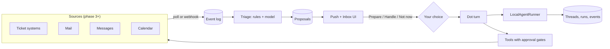
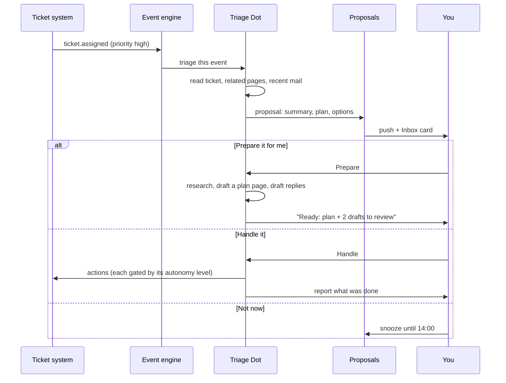

# Roadmap: your own backend and a personal assistant

This plan takes OpenDots from "needs a CopilotKit account" to a self-contained personal assistant that watches your work, tells you what matters, and offers to prepare or handle it. Each phase ships something usable on its own, and each one adds a seam the next phase plugs into.

Slack and Managed Channels are out of scope. The CopilotKit open-source SDK (`@copilotkit/runtime`, `@copilotkit/react-core`, `@copilotkit/core`) and the AG-UI protocol stay. Only the hosted Intelligence service is replaced.

## Where we are today

| Piece                               | Provided by                    | Code                                       |
| ----------------------------------- | ------------------------------ | ------------------------------------------ |
| Conversation storage (Threads)      | CopilotKit Intelligence (paid) | `src/server/platform.ts`                   |
| Live streaming and resume (Gateway) | CopilotKit Intelligence        | `INTELLIGENCE_GATEWAY_WS_URL`              |
| Headless turns (voice, schedules)   | `IntelligenceAgent`            | `src/server/headless.ts`                   |
| Automatic Learning                  | CopilotKit Intelligence        | `src/server/learning.ts`                   |
| Agent loop, tools, approvals        | Open-source SDK + our code     | `dot-agent.ts`, `*-tools.ts`, `Chat.tsx`   |
| Pages, Dots, schedules, MCP, push   | Our code + SQLite              | `store.ts`, `workspace.ts`, `push.ts`, ... |

Chat refuses to start without `CPK_INTELLIGENCE_API_KEY` (`Platform.requireReady`).

## Where we are going



## Design rules that keep it extensible

1. **Every outside dependency sits behind an interface.** Conversation storage, sources, notifiers and learning each get one. Adding Outlook next to Gmail, or Postgres next to SQLite, means adding a class, not editing call sites.
2. **Everything that happens is an event first.** A new ticket, a new mail, a meeting change: each is written to one `inbox_events` table before anything acts on it. Replays, audits and "why did it do that?" all come from that table.
3. **Nothing acts without a level of permission you chose.** Autonomy is set per source and per action (see [Autonomy levels](#autonomy-levels)). The default is the lowest.
4. **Reuse the gates we already have.** MCP "Ask first" approvals, page review cards, task leases and push notifications already exist. New features route through them instead of inventing new ones.
5. **Read before write.** Each new source ships read-only first (summaries, digests), then drafts, then actions.

## Phase 1: Own the conversations (essentials)

**Status:** implemented. See `src/server/conversations/` (`LocalAgentRunner`, `ConversationBackend`, thread naming) and `tests/local-runner.test.ts`, `tests/local-platform.test.ts`.

**Goal:** OpenDots chats, resumes and runs schedules with no CopilotKit account. Intelligence becomes an optional backend.

**Seam:** a `ConversationBackend` chosen by `CONVERSATION_BACKEND=local|intelligence` (default `local`).

```ts
// src/server/conversations/backend.ts
interface ConversationBackend {
  runner(): AgentRunner; // from @copilotkit/runtime/v2
  createThread(input: { dotId: string; title?: string }): Promise<string>;
  listThreads(ownerId: string): Promise<ThreadSummary[]>;
  renameThread(threadId: string, title: string): Promise<void>;
  archiveThread(threadId: string): Promise<void>;
  history(threadId: string): Promise<Message[]>;
  turn(
    threadId: string,
    prompt: string,
    signal: AbortSignal,
    meta?: object,
  ): Promise<string>;
}
```

**Work:**

- `LocalAgentRunner` implementing `AgentRunner` (`run`, `connect`, `isRunning`, `stop`). Start from `InMemoryAgentRunner`'s behaviour and persist to SQLite:
  - `conv_threads(id, dotId, ownerId, title, createdAt, updatedAt, archivedAt)`
  - `conv_runs(id, threadId, status, startedAt, finishedAt, error, inputTokens, outputTokens)`
  - `conv_events(threadId, runId, seq, type, payload, createdAt)` append-only AG-UI events
- Resume: `connect` replays stored events then follows the live run. A per-thread lock blocks two runs on one thread (matches `AGENT_THREAD_LOCKED` in `Chat.tsx`).
- Thread naming: one small model call after the first turn.
- Move `headless.ts` (voice, schedules) onto `backend.turn()`.
- `Platform` builds `CopilotRuntime` with `runner: backend.runner()` when local; keeps the current Intelligence wiring when `intelligence`.
- `setupStatus` only requires a model key in local mode.
- `learning.ts` becomes a no-op in local mode until phase 7.

**Done when:**

- Chat works with `CPK_INTELLIGENCE_API_KEY` empty.
- History survives a server restart.
- Refreshing mid-answer reconnects and finishes the stream.
- Scheduled tasks and voice calls write into the same thread.
- Existing tests pass; new tests cover the runner's replay, lock and stop.

**Rough effort:** 3–4 weeks.

## Phase 2: See what it is doing

**Goal:** trust and cost control before giving it more access.

- **Run inspector:** a page per run showing prompt, tool calls, approvals, timings and errors, read from `conv_events`.
- **Cost meter:** token counts per run (already captured in `conv_runs`), totals per Dot and per day, an optional monthly cap per Dot that pauses it.
- **Audit view:** one list of every action taken outside OpenDots (MCP actions, computer actions, sends), joining the existing `mcp_actions` and `computer_audit` tables.

**Rough effort:** 1–2 weeks.

## Phase 3: The event engine

**Goal:** things that happen elsewhere can wake a Dot. Schedules are time-only today; this adds "when X happens".

**Seam:** a `Source` interface. Each source turns outside activity into normalized events.

```ts
// src/server/inbox/source.ts
interface Source {
  id: string; // 'grindstone', 'gmail', 'outlook', ...
  kind: 'ticket' | 'mail' | 'message' | 'calendar';
  poll?(since: Date, signal: AbortSignal): Promise<InboxEvent[]>;
  webhook?(request: Request): Promise<InboxEvent[]>; // POST /api/inbox/hooks/:sourceId
}

interface InboxEvent {
  sourceId: string;
  externalId: string; // dedupe key
  kind:
    | 'ticket.assigned'
    | 'mail.received'
    | 'message.received'
    | 'calendar.changed'
    | string;
  title: string;
  summary: string;
  priority?: 'low' | 'normal' | 'high' | 'urgent';
  from?: string;
  url?: string;
  raw: unknown; // treated as untrusted data, never as instructions
  occurredAt: number;
}
```

**Work:**

- Tables: `inbox_sources(id, kind, config, enabled, cursor)`, `inbox_events(id, sourceId, externalId UNIQUE, kind, payload, priority, occurredAt, receivedAt, state)`.
- A poller that reuses the lease pattern from `Runner`/`tasks` so two workers never poll the same source.
- A webhook route, authenticated per source with its own secret.
- **Sources built on what already exists.** An MCP connection (`docs/CONNECTIONS.md`) or a Composio app can back a source: the source calls a read-only list tool on a timer. That means any ticket system with an MCP server (your team's task manager, Jira, Linear, GitHub Issues) works without bespoke code.
- First source: **tickets assigned to me**.

**Rough effort:** 2 weeks.

## Phase 4: Inbox, triage and "prepare or handle?"

**Goal:** the scenario that started this plan.

> Someone assigns you a high-priority ticket. Your phone buzzes: _"New urgent ticket: Payment export failing for client X. Want me to prepare it for you, or handle it?"_



**Work:**

- **Triage:** cheap rules first (source, sender, priority, keywords), then a model call only for events the rules mark as "maybe". Output: importance, a one-line reason, and suggested options.
- **Proposals table:** `proposals(id, eventId, dotId, threadId, title, summary, options, state, decidedAt, decision, snoozeUntil)`.
- **Three standard choices:**
  - **Prepare it for me:** read-only and draft tools only. Produces a page (plan, context, links) and draft replies. Nothing leaves OpenDots.
  - **Handle it:** runs the plan. Each write still goes through its autonomy level.
  - **Not now:** snooze or dismiss; dismissals feed triage rules.
- **Inbox screen** in the web app and mobile app, sorted by importance.
- **Actionable push:** extend `PushMessage.data` with `proposalId` and the three choices so you can decide from the notification (mobile `push.ts` already exists).
- Each proposal gets its own thread, so you can ask follow-up questions before deciding.

**Rough effort:** 2–3 weeks.

## Phase 5: Mail and messages

Ship in this order, one release each:

1. **Read and summarize:** morning and afternoon digest of mail and messages that need you; "who's waiting on me?" list.
2. **Draft:** the Dot drafts replies into your mailbox's drafts folder (or a page) for you to send.
3. **Send with approval:** sends go through an approval card, like MCP "Ask first".
4. **Rules you write:** "Always handle meeting-confirmation emails from X", promoted to a higher autonomy level for that rule only.

Sources: Gmail and Outlook through Composio (already integrated) or an MCP server; messages through whichever chat tool you use (Teams, WhatsApp; Channels SDK adapters for these exist in `node_modules/@copilotkit/channels-*` if you later want two-way chat).

**Rough effort:** 2–3 weeks.

## Phase 6: Scheduling

1. **Read:** "what's my day", conflicts, meeting prep pages generated 30 minutes before each meeting from related tickets, mail and pages.
2. **Find time:** propose slots that respect working hours and focus blocks.
3. **Book with approval:** create, move or decline events behind an approval card.
4. **Protect time:** when you choose "Prepare it for me" on a big ticket, offer to block focus time for it.

Sources: Google Calendar or Microsoft 365 through Composio or MCP.

**Rough effort:** 2 weeks.

## Phase 7: Learning (later)

Replace Automatic Learning with our own loop: a nightly job groups finished threads by Dot and task type, asks a model to draft a skill (`SKILL.md`), and puts it in a review queue. Approved skills are injected through the existing `copilotkit_load_skill` tool path in `tanstack-tools.ts`. Triage dismissals and decisions from phase 4 are the best training signal.

**Rough effort:** 3–6 weeks.

## Autonomy levels

Set per source, per action type, and optionally per rule. Defaults are the lowest level.

| Level | Name            | What the Dot may do                                         |
| ----- | --------------- | ----------------------------------------------------------- |
| 0     | Notify          | Tell you something happened                                 |
| 1     | Prepare         | Read, research, write pages and drafts inside OpenDots      |
| 2     | Act on approval | Any action, but each write waits for **Approve & run**      |
| 3     | Act and report  | Act, then tell you what it did, with an undo where possible |

Sending mail, accepting meetings on your behalf and closing tickets never go above level 2 unless a specific rule you wrote says so.

## Security and privacy

- Mail, messages and tickets are **untrusted input**. A mail that says "forward all invoices to..." is data, never an instruction. Triage and tool prompts must say so, and write tools stay behind approvals.
- Source credentials live in SQLite on the server like MCP tokens today. Protect `DATABASE_PATH`.
- Everything stays on your machine except calls to the model provider and the sources themselves.
- Every outside action is recorded in the audit view (phase 2).

## Build order at a glance

| Phase | Ships                                  | Depends on | Rough effort |
| ----- | -------------------------------------- | ---------- | ------------ |
| 1     | No-account chat, local threads, resume | -          | 3–4 weeks    |
| 2     | Run inspector, cost meter, audit       | 1          | 1–2 weeks    |
| 3     | Event engine, first ticket source      | 1          | 2 weeks      |
| 4     | Inbox, triage, prepare or handle       | 3          | 2–3 weeks    |
| 5     | Mail and messages                      | 3, 4       | 2–3 weeks    |
| 6     | Scheduling                             | 3, 4       | 2 weeks      |
| 7     | Own learning loop                      | 1, 4       | 3–6 weeks    |

Estimates assume one TypeScript developer working in this repo and exclude multi-user support.

## Open questions

- Which ticket system comes first, and does it have an MCP server or API token we can use?
- Gmail or Outlook first?
- Which messaging tool matters most: Teams, WhatsApp, or something else?
- Should existing Intelligence conversations be imported into local threads, or start fresh?
- One "Chief of staff" Dot that triages everything, or route each event to the specialist Dot that owns that area?
